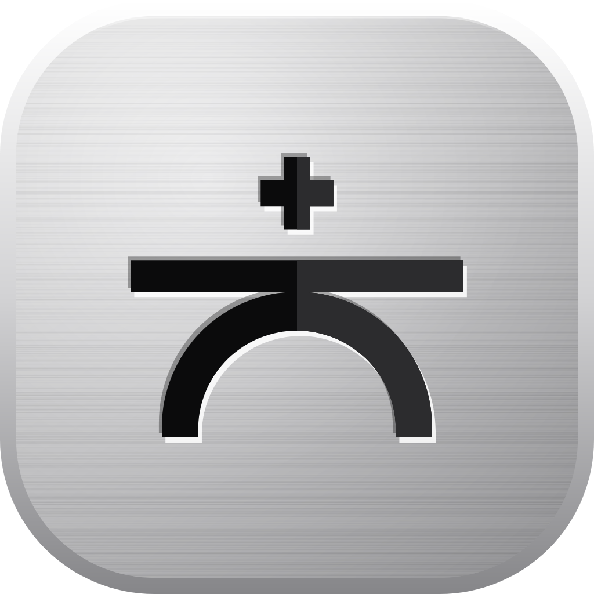

<p align="center">
  
</p>

<h1 align="center">BridgePlus</h1>

<p align="center">
  Le téléphone et le PC, <b>reliés</b>.<br>
  Presse-papiers, fichiers et notifications passent par le Wi-Fi de la maison.<br>
  Pas de cloud, pas de compte, pas de câble.
</p>

<p align="center">
  <a href="https://github.com/Maubin76/BridgePlus/actions/workflows/ci.yml"></a>
  <a href="https://github.com/Maubin76/BridgePlus/releases/latest"></a>
  
  
  
</p>

<!-- Captures du téléphone et du PC : étape 6. -->

## En bref

BridgePlus fait passer une information du téléphone au PC, ou l'inverse, **en un geste et en moins de
deux secondes**.

- **Chez vous, et seulement chez vous** : le téléphone et le PC se parlent directement par le
  Wi-Fi de la maison. Hors de chez vous, BridgePlus se met en veille.
- **Appairé une fois, relié pour toujours** : on scanne un QR code, puis la liaison se rétablit
  toute seule dès que les deux appareils sont à la maison.
- **Chiffré de bout en bout** : chaque paire a sa propre clé, qui passe par l'appareil photo et
  jamais par le réseau. Voir [la cryptographie, en clair](doc/CRYPTOGRAPHIE.md).
- **Discret** : une icône près de l'horloge du PC, une notification minimale sur le téléphone,
  « Relié à Bureau ».

## Où en est-on

| Étape | Contenu | État |
|---|---|---|
| 1 | Modules, thème, liaison chiffrée, appairage par QR code, connexion permanente avec reconnexion | ✅ |
| 2 | Presse-papiers dans les deux sens, contenus sensibles exclus | à venir |
| 3 | Historique chiffré, carte du PC (Ctrl+Alt+V) | à venir |
| 4 | Envoi de fichiers dans les deux sens | à venir |
| 5 | Notifications du téléphone sur le PC | à venir |
| 6 | Sonnerie, batterie, liens, assistant de premier lancement | à venir |

## Installer

- **Téléphone** : APK de la [dernière version](https://github.com/Maubin76/BridgePlus/releases/latest).
- **PC** : zip portable de la même page ; dézippez-le où vous voulez et lancez `BridgePlus.exe`.
  Au premier appairage, Windows demande d'autoriser BridgePlus sur le réseau : cochez seulement
  **Réseaux privés**.

Puis, sur le PC : **Appairer un téléphone**. Sur le téléphone : **Appareils › Appairer un PC**, et
visez le QR code.

### Les autorisations du téléphone, et pourquoi

| Autorisation | Pourquoi |
|---|---|
| Localisation « Toujours » | Android range la lecture du **nom du Wi-Fi** sous la localisation. C'est le seul moyen de reconnaître la maison, appli fermée. Aucune position n'est lue. |
| Fonctionner en arrière-plan (batterie) | Sans elle, Android interdit de relancer la liaison au retour à la maison. |
| Notifications | Pour la notification discrète « Relié à <PC> ». |
| Appareil photo | Pour lire le QR code d'appairage, rien d'autre. |

## Construire

```bash
bash ci/polices.sh            # polices Satoshi (licence : non versionnées)
./gradlew build               # tout construire, tous les tests, lint ; zéro avertissement
./gradlew :desktop:run        # lancer l'appli PC
./gradlew :app:installDebug   # installer l'appli sur le téléphone branché
```

Modules : `:core` (Kotlin pur : liaison, appareils, réglages), `:ui` (Compose partagé : thème,
composants), `:app` (Android), `:desktop` (Windows). La version vaut `1.<nombre de commits>`.
