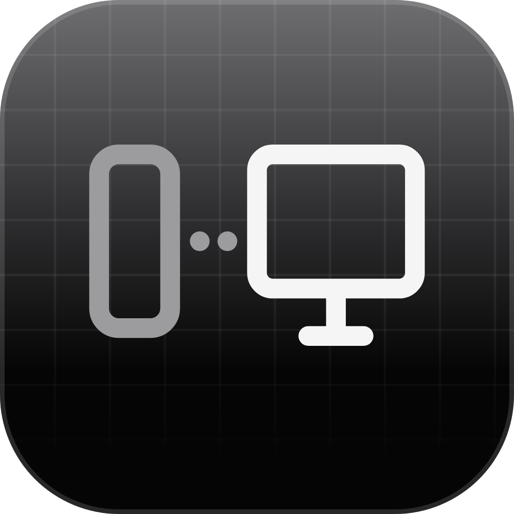
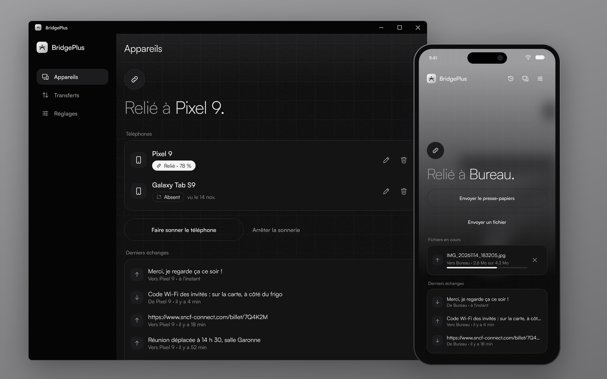
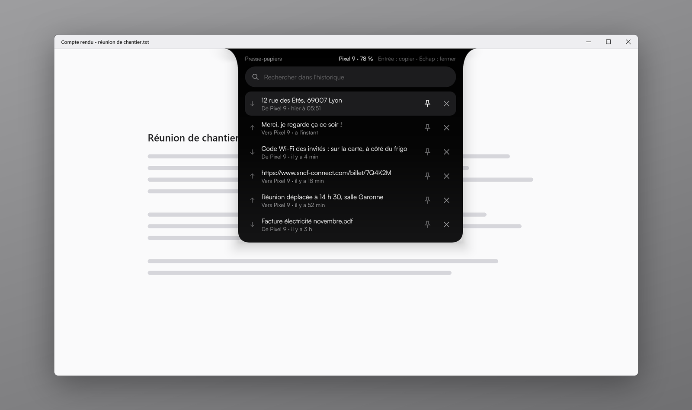
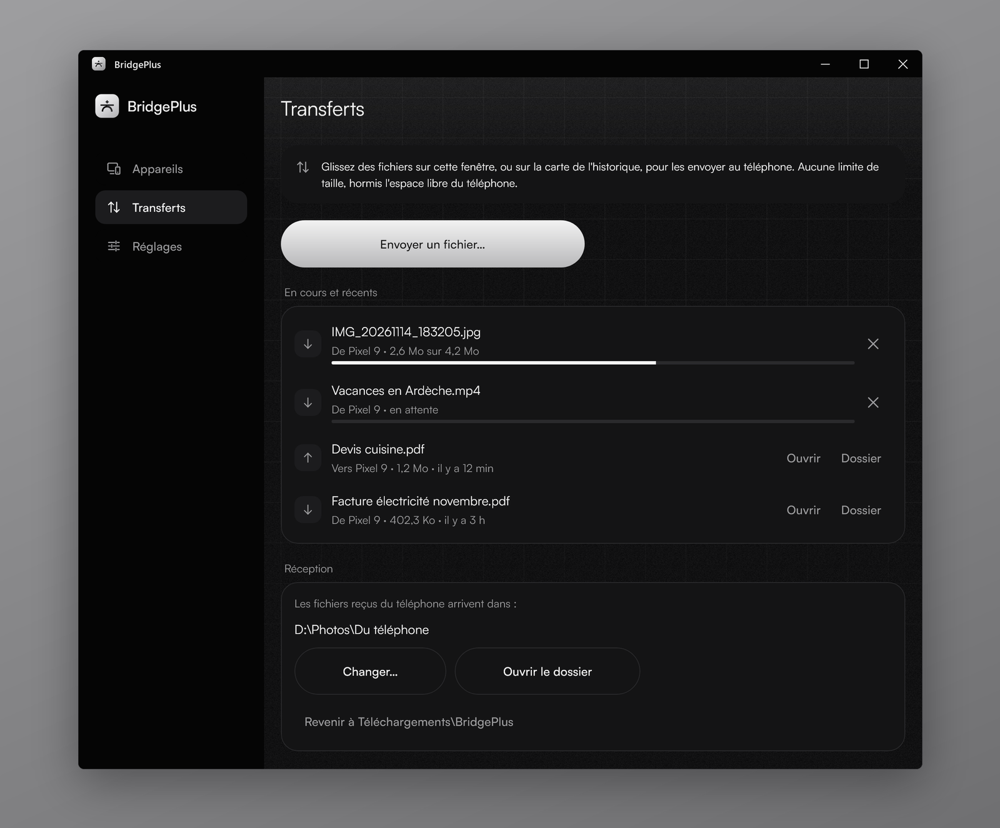
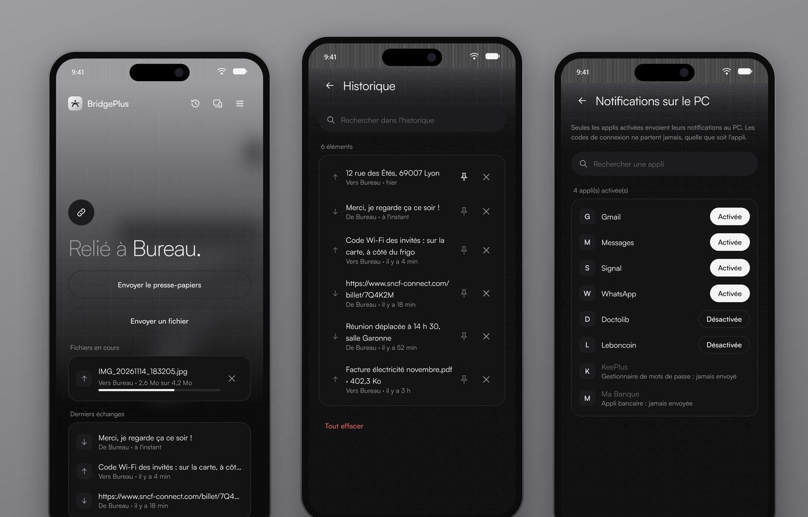
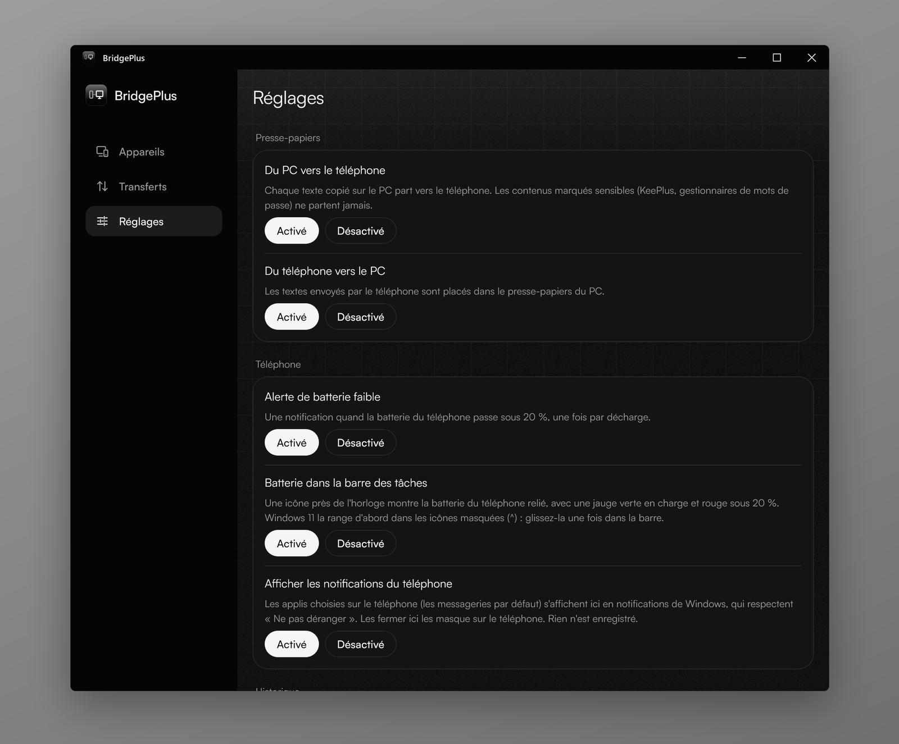
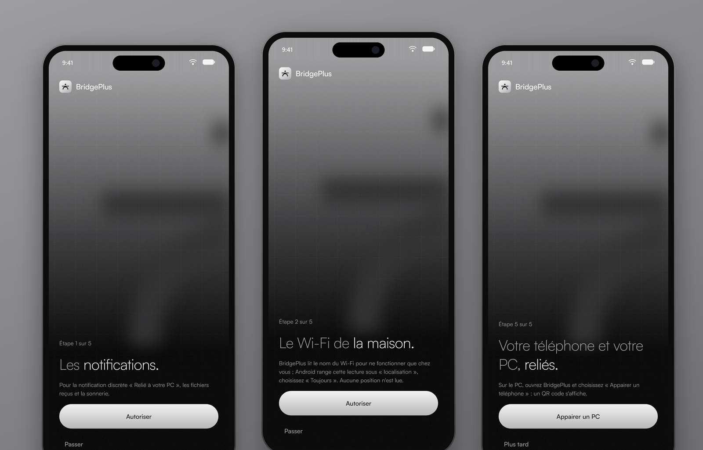

<p align="center">
  
</p>

<h1 align="center">BridgePlus</h1>

<p align="center">
  Le téléphone et le PC, <b>reliés</b>.<br>
  Presse-papiers, fichiers et notifications passent par le Wi-Fi de la maison.<br>
  Pas de cloud, pas de compte, pas de câble.
</p>

<p align="center">
  <a href="https://github.com/Maubin76/BridgePlus/actions/workflows/ci.yml"></a>
  <a href="https://github.com/Maubin76/BridgePlus/releases/latest"></a>
  
  
  
</p>

<p align="center">
  
</p>

## En bref

BridgePlus fait passer une information du téléphone au PC, ou l'inverse, **en un geste et en
moins de deux secondes**.

- **Chez vous, et seulement chez vous** : le téléphone et le PC se parlent directement par le
  Wi-Fi de la maison, sans serveur ni service en ligne. Hors de chez vous, BridgePlus se met en
  veille.
- **Appairé une fois, relié pour toujours** : on scanne un QR code, puis la liaison se rétablit
  toute seule dès que les deux appareils sont à la maison.
- **Chiffré de bout en bout** : chaque paire a sa propre clé, qui passe par l'appareil photo et
  jamais par le réseau.
- **Discret** : une icône près de l'horloge du PC, une notification minimale sur le téléphone,
  « Relié à Bureau ».

## Le presse-papiers, et son historique

<p align="center">
  
</p>

Copiez sur le PC, collez sur le téléphone, et inversement.

- **Du PC vers le téléphone** : chaque texte copié sur le PC arrive dans le presse-papiers du
  téléphone. Si Android refuse, une notification « Texte reçu » propose **Copier**.
- **Du téléphone vers le PC** : Android interdit à une appli en arrière-plan de lire le
  presse-papiers. Trois gestes : la **tuile de réglages rapides** « Envoyer au PC », l'entrée
  **« Envoyer au PC » du menu de partage**, ou simplement **ouvrir BridgePlus** (la copie part
  d'elle-même).
- **L'historique, partout** : `Ctrl + Alt + V` (réglable) fait descendre une carte en haut de
  l'écran, depuis n'importe quelle appli. Tapez pour chercher, flèches et Entrée pour copier : la
  carte remonte et vous collez aussitôt. Une épingle garde un élément, une croix le supprime.
- **Les 50 derniers textes**, et ceux que vous épinglez, sont gardés **chiffrés** sur chaque
  appareil. Le téléphone a le même historique, avec la même recherche.
- **Jamais un secret** : ce que KeePlus, KeePass ou un autre gestionnaire marque comme sensible
  n'est ni lu ni envoyé.

## Les fichiers, sans limite de taille

<p align="center">
  
</p>

- **Du téléphone vers le PC** : « Envoyer au PC » dans le menu de partage (photos, vidéos,
  documents, plusieurs à la fois), ou « Envoyer un fichier » sur l'accueil. Le transfert continue
  écran éteint ; la notification montre l'avancement, avec **Annuler**.
- **Du PC vers le téléphone** : glissez des fichiers sur la fenêtre ou sur la carte de
  l'historique, ou « Envoyer un fichier… » dans le menu de l'icône. En option, « Envoyer au
  téléphone » dans le menu contextuel de l'Explorateur.
- **Réception** : `Téléchargements\BridgePlus\` sur le PC (modifiable), `Download/BridgePlus/` sur
  le téléphone, les photos dans la galerie. Une notification propose **Ouvrir** et **Ouvrir le
  dossier**.
- **Sûr** : empreinte SHA-256 vérifiée à l'arrivée, jamais de fichier à moitié écrit visible,
  jamais d'écrasement (« photo (2).jpg »), espace libre vérifié avant de commencer.

## Les notifications du téléphone, sur le PC

<p align="center">
  
</p>

- Les notifications des applis choisies s'affichent en **notifications de Windows** : icône de
  l'appli, titre, texte, « WhatsApp · Pixel 9 ». Elles respectent « Ne pas déranger ».
- **Liste blanche** sur le téléphone : les messageries sont activées par défaut, le reste ne part
  que si vous l'activez.
- **Jamais** : les gestionnaires de mots de passe, les applis bancaires, les applis
  d'authentification, et tout ce qui ressemble à un code de connexion, quelle que soit l'appli.
- **Masquée d'un côté, masquée de l'autre** : fermer la notification sur le PC la retire du
  téléphone, et inversement.
- Rien n'est enregistré : ni dans l'historique, ni sur le disque, ni dans un journal.

## Au quotidien

<p align="center">
  
</p>

| Fonctionnalité | Description | Android | PC |
|---|---|:---:|:---:|
| **Presse-papiers partagé** | Texte de 1 Mo au plus, dans les deux sens ; chaque sens se désactive | ✅ | ✅ |
| **Contenus sensibles exclus** | Ce qu'un gestionnaire de mots de passe marque sensible n'est jamais lu | ✅ | ✅ |
| **Historique chiffré** | 50 derniers textes et fichiers échangés, épingles, recherche sans accents ni majuscules | ✅ | ✅ |
| **Carte de l'historique** | Appelée par un raccourci global, depuis n'importe quelle appli | — | ✅ |
| **Tuile et menu de partage** | « Envoyer au PC » en un geste, depuis n'importe quelle appli | ✅ | — |
| **Fichiers** | Dans les deux sens, plusieurs à la fois, sans limite de taille, empreinte vérifiée | ✅ | ✅ |
| **Glisser-déposer** | Sur la fenêtre ou la carte ; « Envoyer au téléphone » dans l'Explorateur | — | ✅ |
| **Notifications du téléphone** | Notifications de Windows, liste blanche, fermées des deux côtés | ✅ | ✅ |
| **Faire sonner le téléphone** | À plein volume même en silencieux, arrêt seul après 60 s | ✅ | ✅ |
| **Batterie du téléphone** | Sur le PC : icône dans la barre des tâches (pourcentage et jauge), page Appareils, carte ; alerte facultative sous 20 % | ✅ | ✅ |
| **Liens** | Un lien partagé s'ouvre dans le navigateur de l'autre appareil | ✅ | ✅ |
| **Plusieurs appareils** | Plusieurs téléphones par PC, plusieurs PC par téléphone ; renommer, oublier | ✅ | ✅ |
| **Assistant** | Premier lancement guidé, chaque étape facultative | ✅ | — |
| **Sauvegarde des réglages** | Dans un fichier, sans jamais les clés des paires | ✅ | — |
| **Zone de notification** | L'appli reste près de l'horloge ; démarrage avec Windows au choix | — | ✅ |
| **Mises à jour** | Nouvelle version proposée et installée par l'appli | ✅ | ✅ |

## Un premier lancement guidé

<p align="center">
  
</p>

Cinq étapes courtes, chacune expliquée en une phrase et facultative : notifications, Wi-Fi de la
maison, arrière-plan, accès aux notifications, appairage. L'assistant se relance depuis les
réglages.

## Sécurité

Le détail, expliqué sans prérequis et en schémas : [**la cryptographie de BridgePlus**](doc/CRYPTOGRAPHIE.md).

| Sujet | Ce que fait BridgePlus |
|---|---|
| **Appairage** | Clé de 256 bits propre à chaque paire, transmise par le QR code (valable 5 minutes), jamais par le réseau |
| **Liaison** | Ouverture scellée en AES-256-GCM avec défis et protection contre le rejeu ; deux clés de session par HKDF-SHA256, une par sens |
| **Trames** | Numéro d'ordre authentifié servant de nonce : une trame rejouée, déplacée ou supprimée coupe la connexion |
| **Clés au repos** | Keystore Android sur le téléphone, DPAPI sur le PC ; « Oublier » détruit la clé des deux côtés |
| **Presse-papiers** | Contenus marqués sensibles jamais lus ; aucun texte dans un journal |
| **Fichiers** | Nom nettoyé (aucune écriture hors du dossier de réception), empreinte SHA-256 vérifiée |
| **Notifications** | Filtre appliqué sur le téléphone avant l'envoi ; codes de connexion jamais envoyés ; rien d'enregistré |
| **Liens `bridgeplus:`** | Ne portent qu'un identifiant tiré au hasard, jamais un chemin |
| **Réseau** | Le PC n'écoute que sur le réseau de la maison ; seule la vérification des mises à jour interroge GitHub |

## Installation

Téléchargez les fichiers de la [dernière release](https://github.com/Maubin76/BridgePlus/releases/latest) :

- **Android** : `BridgePlus-X.Y.apk`, à ouvrir sur le téléphone.
- **Windows** : `BridgePlus-X.Y-windows.msi`, ou le zip portable (dézippez-le où vous voulez et
  lancez `BridgePlus.exe` ; c'est cette version qui se met à jour seule, sans droit
  administrateur). La JVM est incluse.

Puis, sur le PC : **Appairer un téléphone**. Sur le téléphone : **Appareils › Appairer un PC**, et
visez le QR code. Au premier appairage, Windows demande d'autoriser BridgePlus sur le réseau :
cochez seulement **Réseaux privés**.

### Les autorisations du téléphone, et pourquoi

| Autorisation | Pourquoi |
|---|---|
| Localisation « Toujours » | Android range la lecture du **nom du Wi-Fi** sous la localisation. C'est le seul moyen de reconnaître la maison, appli fermée. Aucune position n'est lue. |
| Fonctionner en arrière-plan (batterie) | Sans elle, Android interdit de relancer la liaison au retour à la maison. |
| Notifications | Pour la notification discrète « Relié à votre PC », les fichiers reçus et la sonnerie. |
| Appareil photo | Pour lire le QR code d'appairage, rien d'autre. |
| Accès aux notifications | Pour afficher sur le PC les notifications des applis choisies. Android 16 le protège pour une appli installée hors du Play Store : Infos de l'appli › ⋮ › Autoriser les paramètres restreints ; l'appli guide pas à pas. |

### Consommation

La liaison reste ouverte tant que le téléphone est à la maison : un battement toutes les 30 s,
envoyé par le PC. Mesure sur une journée : [la marche à suivre et le résultat](doc/BATTERIE.md).

## Pour les développeurs

BridgePlus est écrit en **Kotlin** avec **Compose Multiplatform** : l'interface est commune au
téléphone et au PC, dans la direction artistique de KeePlus.

| Module | Rôle |
|---|---|
| `core` | Liaison chiffrée, appairage, découverte, presse-papiers, historique, transferts, notifications, réglages, mises à jour (JVM pur) |
| `ui` | Interface commune : thème, logo, composants, écrans clés et de travail |
| `app` | Appli Android : service de liaison, tuile, partage, lecture des notifications, scan du QR code |
| `desktop` | Appli Windows : zone de notification, carte de l'historique, notifications de Windows, Explorateur |

```bash
bash ci/polices.sh            # polices Satoshi (non versionnées, voir plus bas)
./gradlew build               # tout construire, tous les tests, lint ; zéro avertissement
./gradlew :desktop:run        # appli PC
./gradlew :app:installDebug   # appli Android sur le téléphone branché
```

- **CI** : à chaque push sur `main` ou `develop`, tous les tests ; sur `main`, APK signé,
  installateur `.msi`, zip portable et release GitHub. La version vaut `1.<nombre de commits>`.
- **Visuels de ce README** : `ReadmeScreenshotsTest` rend hors écran la fenêtre, la carte et les
  écrans du téléphone avec des données d'exemple, puis `python ci/vitrines.py` les pose dans
  leurs cadres. Le workflow « Visuels du README » fait les deux et joint le résultat.
- **Logo** : dessiné dans `ui/.../theme/Logo.kt` ; `LogoAssetsTest` régénère les icônes.
- **Direction artistique** : [`DESIGN.md`](DESIGN.md) ; intentions du produit : [`PRODUCT.md`](PRODUCT.md).

## Polices

**Satoshi** © Indian Type Foundry, [licence ITF Free Font](licenses/Satoshi-FFL.txt) : intégrée à
l'appli, mais sa licence interdit de la publier dans un dépôt. Elle est donc téléchargée depuis
[Fontshare](https://www.fontshare.com/fonts/satoshi) à chaque construction (`ci/polices.sh`).
