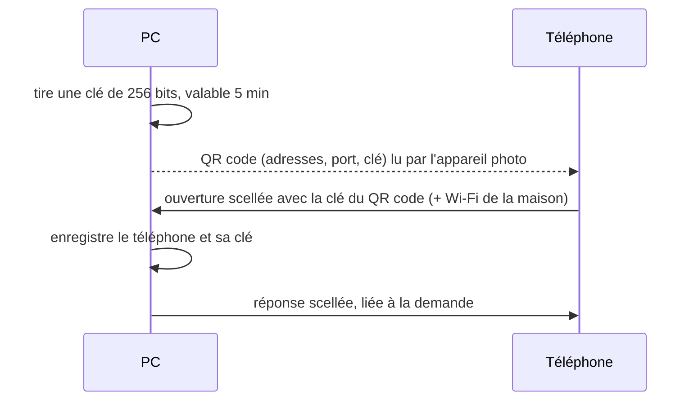

# BridgePlus — la cryptographie, en clair

BridgePlus fait passer des textes copiés, des fichiers et des notifications entre le téléphone et le
PC. Tout passe **directement par le Wi-Fi de la maison**, et tout est **chiffré de bout en bout**
avec une clé que seuls les deux appareils connaissent. La base vient de KeePlus (appairage par QR
code, messages scellés en AES-GCM). BridgePlus y ajoute des **sessions** : une connexion reste ouverte
en permanence, avec des clés propres à chaque session.

## L'appairage : la clé passe par vos yeux, pas par le réseau



- La clé n'est jamais envoyée sur le réseau : elle passe de l'écran du PC à l'appareil photo.
- Une offre expirée (plus de 5 minutes) ne peut plus rien ouvrir.
- Chaque paire a sa propre clé. **Oublier un appareil détruit sa clé** des deux côtés : il ne peut plus se connecter, même s'il garde une copie de l'ancien fichier.

## L'ouverture d'une session

1. Le téléphone envoie une trame `open` **scellée** (AES-256-GCM) avec la clé de la paire. Elle porte un **défi** de 32 octets tiré au hasard.
2. Le PC vérifie la trame :
   - la clé de cet appareil l'ouvre (sinon : « appareil non appairé ») ;
   - sa date est à moins de 5 minutes et son numéro à usage unique n'a jamais été vu (protection contre le rejeu de KeePlus) ;
   - l'expéditeur annoncé est bien celui de la trame.
3. Le PC répond par une trame scellée avec la même clé, **liée à la demande** (son numéro figure dans les données authentifiées) et portant son propre défi.
4. Chaque côté calcule **deux clés de session**, une par sens, avec HKDF-SHA256 (RFC 5869) :
   `HKDF(clé de la paire, sel = défi du téléphone ‖ défi du PC, « BridgePlus 1 vers le PC » / « … vers le téléphone »)`.

## Les trames d'une session

```
[longueur u32][nature u8 = 2][numéro d'ordre u64][AES-256-GCM(clé du sens, nonce = 0⁴ ‖ numéro, AAD = numéro)]
```

- **Numéro d'ordre** : 0, 1, 2… dans chaque sens. Il sert de nonce (jamais deux fois le même avec une clé de session) et il est authentifié. Une trame **rejouée, déplacée, supprimée** ou venue d'une **autre session** ne s'ouvre pas, et la connexion est coupée.
- Ce mécanisme ne dépend plus de l'heure des appareils après l'ouverture, et il évite la limite d'environ 2³² messages par clé d'AES-GCM avec des nonces tirés au hasard.
- Le contenu en clair commence par un octet de nature : message JSON, ou morceau de fichier binaire (pas de base64 : un fichier ne grossit pas d'un tiers).
- Une trame fait 64 Mo au plus, comme dans KeePlus.

**En clair sur le réseau** : seulement la présentation (`hello`, nom et version de l'appareil, pour le diagnostic) et les refus (`error`). Rien d'autre.

## Battement de cœur

Le PC envoie un `Ping` scellé toutes les 30 s et le téléphone répond `Pong`. C'est le PC qui parle, parce qu'un paquet reçu réveille le téléphone en veille, alors que ses propres minuteurs s'y arrêtent. Sans rien recevoir pendant 75 s (PC) ou 90 s (téléphone), la session est déclarée morte. Le téléphone se reconnecte après 1, 2, 4… jusqu'à 60 s au plus, et tout de suite au retour sur le Wi-Fi.

## Où vivent les clés

| Appareil | Fichier | Protection |
|---|---|---|
| Téléphone | `appareils.bin` (stockage privé) | AES-256-GCM, clé du **Keystore Android** (ne quitte pas le matériel sécurisé) ; exclu des sauvegardes et des transferts |
| PC | `%APPDATA%\BridgePlus\appareils.bin` | **DPAPI** (liée au compte Windows) |

Un fichier scellé avec une autre clé (autre compte, clé perdue) est mis de côté (`.illisible`), jamais écrasé sans trace ; il faut alors appairer de nouveau.

## Le réseau

- Le PC **n'écoute que sur les interfaces du réseau de la maison** (reconnu par le nom du Wi-Fi ou l'adresse matérielle de la box), plus celles du réseau actuel le temps d'un appairage. Il ne répond à la découverte (`BRIDGEPLUS?1`, UDP 47840) que pour une demande venue de ces sous-réseaux.
- Le téléphone ne tient la liaison que sur le Wi-Fi de la maison ; ailleurs, le service s'arrête.
- Ports : TCP 47841, UDP 47840. Ceux de KeePlus (47821, 47820) ne sont pas utilisés, et les deux applis cohabitent.

## Références

AES-GCM (NIST SP 800-38D), HKDF (RFC 5869), Android Keystore, DPAPI. Paramètres dans le code : `core/src/main/kotlin/fr/maubin/bridgeplus/link/LinkCrypto.kt` et `LinkProtocol.kt`.
